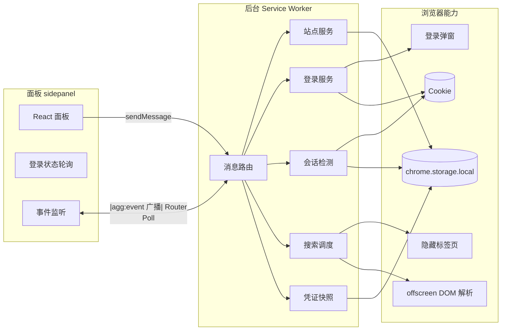
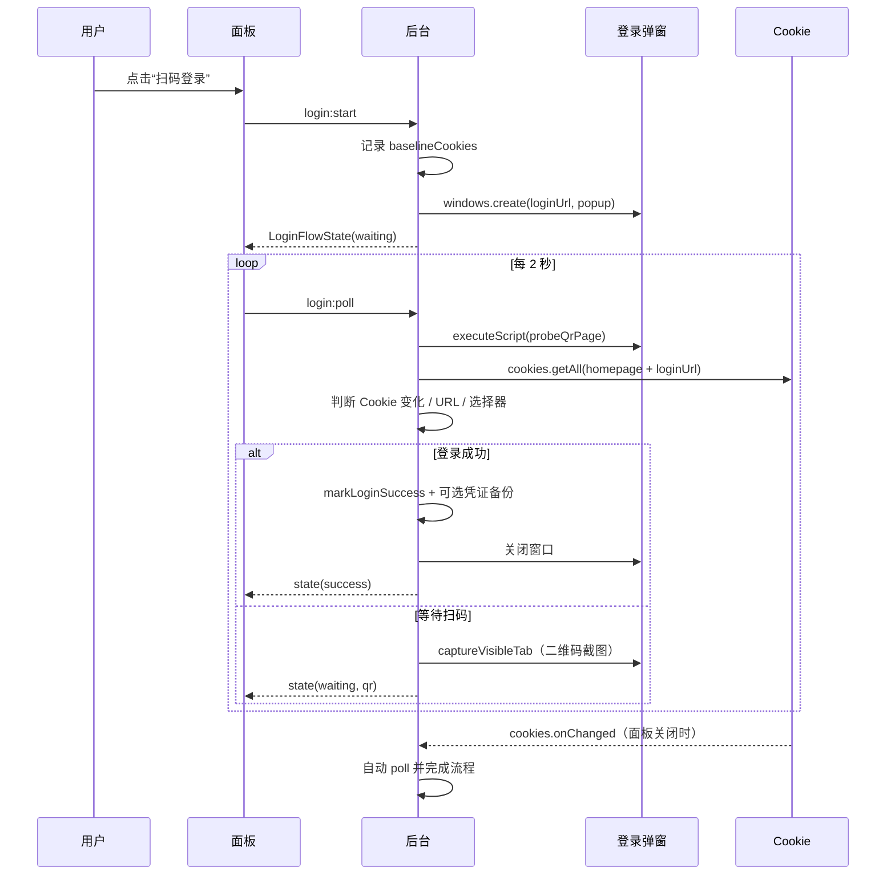
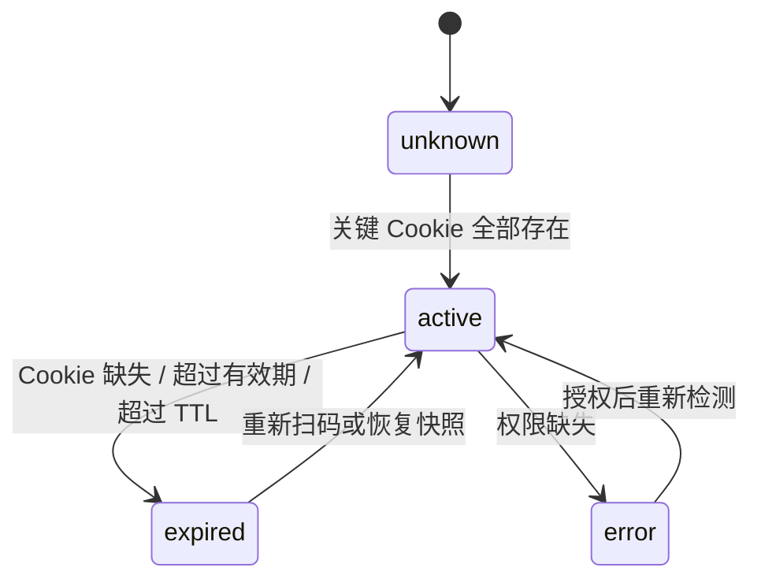
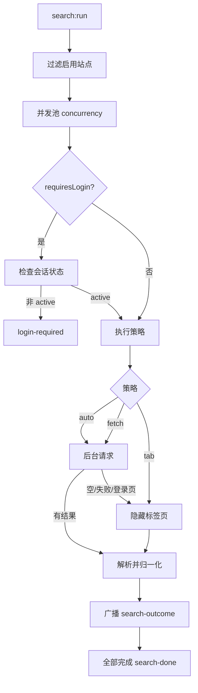
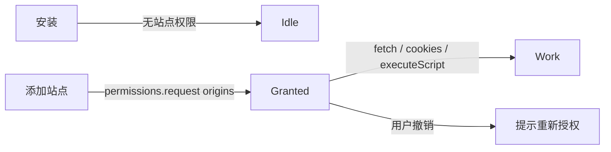

# 设计文档：多站点扫码登录 + 聚合搜索面板

## 1. 目标与范围

把“需要扫码登录的多个站点”收敛到一个侧边栏面板：

1. 维护站点列表（主页、登录页、搜索地址、结果选择器、登录检测规则）
2. 在面板中展示各站点的登录二维码，扫码后自动识别登录成功
3. 登录态持久保存，过期后自动检测并提醒重新扫码
4. 输入关键词跨站点搜索，分组展示结果，点击直达原页面

非目标：

- 不代替浏览器保存密码，不实现站点自身的登录协议
- 不上传、不同步任何登录数据
- 不绕过站点的访问控制或反爬策略

## 2. 技术选型

| 关注点 | 选择 | 理由 |
| --- | --- | --- |
| 扩展规范 | Manifest V3 | Edge/Chromium 当前规范 |
| 面板 UI | React 18 + TypeScript | 状态较多（站点、会话、二维码、搜索进度），组件化更易维护 |
| 构建 | esbuild 单脚本 | 无常驻开发服务器、三种产物（IIFE）打包快，依赖少 |
| HTML 解析 | offscreen + DOMParser | Service Worker 无 DOM，用官方 offscreen 能力 |
| 二维码读取 | 注入页面函数 + `captureVisibleTab` 兜底 | 兼容 img/canvas/div 多种二维码载体 |
| 登录检测 | Cookie 为主 + URL/选择器为辅 | Cookie 是所有站点登录态的共同落点 |
| 测试 | Vitest + happy-dom | 纯逻辑与 DOM 提取均可覆盖 |

## 3. 整体架构



关键约束：

- **Service Worker 随时可能被终止**。登录窗口信息、会话、站点配置全部落在 `chrome.storage.local`；
  二维码截图只放内存，SW 重启后面板轮询会重新抓取。
- **Service Worker 不能长时间定时**。二维码轮询由面板驱动（每 2 秒一次消息），
  登录成功还可以由 `cookies.onChanged` / `tabs.onUpdated` 唤醒后台触发检测。
- **面板可能关闭**。扫码成功后若面板不在，Cookie 事件会触发后台自动完成登录流程。

## 4. 数据模型

```ts
SiteConfig {
  id, name, homepage, iconUrl, enabled, notes, origins[]
  login: {
    loginUrl
    qrSelector?, refreshButtonSelector?
    successUrlPattern?, successCookieName?, successSelector?
    sessionCookieNames[]        // 过期判断核心
    sessionTtlMinutes?          // 兜底有效期
    autoDetectAuthCookie
  }
  search: {
    urlTemplate                  // 必含 {q}
    resultSelector?, titleSelector?, linkSelector?, snippetSelector?
    api?: { urlTemplate, method, bodyTemplate?, headers?, listPath, titlePath, linkPath, snippetPath? }
    maxResults?, strategy?: 'auto'|'fetch'|'tab'
    requiresLogin
  }
  createdAt, updatedAt
}

SiteSession {
  siteId, status: 'unknown'|'checking'|'active'|'expired'|'error'
  loginAt?, lastCheckedAt?, expiresAt?, accountLabel?, message?
}

Settings {
  maxResultsPerSite, concurrency, defaultStrategy,
  notifyOnExpire, vaultEnabled, openLinksInNewTab,
  closeLoginWindowOnSuccess, sessionCheckMinutes
}

PersistedLoginFlow {
  siteId, windowId, tabId, startedAt, loginUrl, homepage,
  baselineCookies: Record<string, string>   // 开窗时的关键 Cookie 值
}
```

设计要点：

- `origins` 由主页、登录页、搜索地址、接口地址自动推导，用于动态申请主机权限
- 会话只保存元数据，不保存 Cookie 值
- `baselineCookies` 用于区分“开窗前已登录”与“本次扫码后新增/变化的登录态”，避免误判

存储键统一在 `src/shared/constants.ts` 中维护：

| 键 | 内容 |
| --- | --- |
| `agg.sites` | 站点配置数组 |
| `agg.sessions` | siteId → 会话元数据 |
| `agg.settings` | 全局设置 |
| `agg.flows` | siteId → 登录窗口信息（不含二维码） |
| `agg.history` | 最近搜索关键词 |
| `agg.vaultKey` / `agg.vault` | 快照密钥与加密条目 |

## 5. 扫码登录

### 5.1 时序



### 5.2 二维码定位

注入页面的 `probeQrPage` 是**自包含函数**（不引用模块变量），Chrome 序列化后在页面上下文执行：

1. 优先使用用户配置的 `qrSelector`
2. 否则扫描常见选择器：`img[src*="qr"]`、`canvas`、`[class*="qrcode"]`、`[id*="qr"]` 等
3. 再兜底扫描所有尺寸 ≥ 96px 的图片 / 画布
4. 按“是否正方形、尺寸区间、是否在视口内、选择器优先级”评分
5. 返回 `imageSrc`（img/canvas 转 dataURL）+ 元素裁剪区域 + 是否含 iframe

面板展示策略：

- 优先 ``（dataURL 或站点图片地址）
- 图片加载失败时使用整窗截图 + `background-position` 裁剪
- 两者都没有时提示“请在登录窗口中扫码”

> 截图仅保存在 `runtimeState` 的内存中，不写入存储。

### 5.3 成功判定

按可靠性从高到低：

1. **关键 Cookie 已完成新登录**：配置的 `sessionCookieNames` 全部存在，且值相对 baseline 变化或为新增
2. **成功 Cookie 出现**：`successCookieName`（保存时自动并入关键 Cookie）
3. **页面出现成功元素**：`successSelector` 命中
4. **URL 命中成功正则**：`successUrlPattern`
5. **自动识别**（无显式规则时）：
   - 对比开窗前后 Cookie，新出现且名称/高熵值像认证凭证的 Cookie
   - 或离开登录页（同域不同路径 / 跨域）作为兜底信号

5. **复用已有登录态**（本次修复）：关键 Cookie 已全部存在，且登录窗口已经离开登录页（例如已登录时
   登录页自动跳回首页），直接视为登录成功，不会因为 Cookie 值未变化而一直停留在“未登录”

成功后的动作：

- 写入 `SiteSession { status: 'active', loginAt, expiresAt }`
- 若开启 `vaultEnabled`，加密备份当前 Cookie
- 广播 `login-state` / `session-updated`
- 可选自动关闭登录窗口

补充：打开扫码窗口前会先同步一次真实登录状态；面板启动时也会主动检测全部站点，
因此浏览器中已登录的站点无需手动操作即会显示“已登录”。

## 6. 登录态检测与过期提醒



判定规则（`src/shared/session-utils.ts`）：

1. 有会话且配置了关键 Cookie：
   - 任一缺失 → `expired`，消息列出缺失名称
   - 全部存在 → 取 Cookie 真实过期时间与 TTL 的较小值
2. 无关键 Cookie：只依赖 TTL；未配置 TTL 时保持 `active` 并提示“无法自动检测”
3. 首次使用、浏览器中已存在登录 Cookie → 直接认领为 `active`
4. 配置的关键 Cookie 全部未找到时，使用高置信度名称白名单
   （`SESSDATA`、`z_c0`、`sessionid`、`web_session`、`SUB`、`dbcl2`、`BDUSS` 等，精确匹配）
   兜底识别登录态，并在状态说明中提示“关键 Cookie 未找到，已按自动识别的 … 判定”；
   不使用高熵值猜测，避免把 `buvid3`、`_ga` 等匿名设备 Cookie 误判为登录

诊断与修复：

- `sessions:diagnose` 返回授权状态、配置/匹配/自动识别的 Cookie 名称、读取到的全部 Cookie 名称与读取错误
- 面板在“检测”未通过时自动弹出诊断，可一键把自动识别到的 Cookie 写回站点配置（`sites:set-session-cookies`）
- 诊断只展示 Cookie 名称，不读取或展示 Cookie 值

触发检测的时机：

- 面板启动时自动检测全部站点（浏览器中已登录的站点会直接显示“已登录”）
- `chrome.alarms` 周期任务（默认 5 分钟，可配置 1~120）
- 面板打开、搜索前（`requiresLogin` 站点）
- 用户点击“检测”
- 登录流程轮询期间

过期处理：

- `chrome.notifications` 系统通知（同一次失效只提醒一次）
- 面板顶部“有登录已过期”入口 + 站点卡片红色状态
- 重新扫码按钮直接复用同一登录流程

## 7. 搜索

### 7.1 调度



- 单站点超时 30 秒（`SEARCH_TIMEOUT_MS`），整批可取消
- 结果统一为 `{ siteId, siteName, title, url, snippet }`
- 去重键：移除 hash 与 `utm_*`/`spm` 等跟踪参数后的 URL
- **同站过滤**：默认只保留属于站点域名的结果（`sameSiteOnly !== false`），
  域名范围 = 主页/登录页/搜索页的主域 + `allowedDomains`，判断规则为
  `host === domain || host.endsWith('.' + domain)`；被过滤数量写入 outcome 的 message
- 结果事件逐站点推送，面板实时填充，无需等待全部完成

### 7.2 后台请求策略

1. 若配置了 JSON 接口：
   - 替换 `{q}`，带 `credentials: 'include'` 调用
   - 按 `listPath/titlePath/linkPath/snippetPath` 映射
   - 401/403 → `LoginRequiredError`
2. 否则抓取搜索页 HTML：
   - 重定向到登录页、401/403 → `LoginRequiredError`
   - 页面含“扫码登录/请先登录”等提示且无结果 → `LoginRequiredError`
   - 通过 offscreen 的 DOMParser 解析，提取函数与标签页策略共用

### 7.3 隐藏标签页策略

1. `chrome.tabs.create({ active: false })`
2. 等待 `status === 'complete'`（15 秒超时）
3. 注入 `extractPageResults`，空结果时按 500ms / 1200ms / 2000ms 重试
4. 若最终 URL 是登录页 → `LoginRequiredError`
5. `finally` 中关闭标签页

### 7.4 通用结果提取启发式

当用户没有配置选择器时（`src/shared/injected/extract-results.ts`）：

1. 收集页面所有 `a[href]`
2. 过滤：短文本、登录/注册/导航文案、登录相关地址、无协议链接
3. 图片卡片兜底：链接本身没有文字时（小红书、Pinterest 等），
   从最近的 `li/article/section/[class*="note"]/[class*="item"]/[class*="card"]` 容器中取
   `h1~h4`、`[class*="title"]`、`img[alt]` 作为标题，并回车到通用提取
4. 为每个候选计算权重：
   - 标题长度、是否包含关键词
   - 是否位于 `main/article/[class*="result"]` 等正向容器
   - 是否位于 `nav/header/footer` 等噪声容器（减分）
   - 所在容器是否包含标题元素
5. 按权重排序，保留前 N 条
6. 摘要取最近一个“文本量合适”的父容器，去掉标题部分
7. 用户配置了选择器但匹配 0 条时，自动回退到上述通用逻辑

结果不足时宁可少返回，也不把整页导航当作结果。

## 8. 凭证快照（可选）

- 用户手动点击“备份登录凭证”，或开启设置后登录成功自动备份
- 收集主页与登录页可见 Cookie → JSON → AES-GCM-256 加密（随机 12 字节 IV）→ 存储
- 恢复时解密，逐条 `cookies.set`；已过期的条目跳过并计入失败数
- 恢复后立即重新检测会话
- 密钥由 `crypto.getRandomValues` 生成并保存在 `agg.vaultKey`
- 这是“本地加密存储”，不是端到端加密；README 已明确其安全边界

## 9. 消息协议

面板 → 后台（`PanelRequest`，统一返回 `{ ok, data } | { ok, error }`）：

| 请求 | 说明 |
| --- | --- |
| `app:snapshot` | 站点、会话、设置、历史、登录流程快照 |
| `settings:update` | 更新设置并重建检测 alarm |
| `sites:save/delete/set-enabled` | 站点增删改 |
| `sites:import/export` | 配置迁移 |
| `sessions:check` | 检测单个或全部站点 |
| `sessions:diagnose` | 诊断登录态：权限、Cookie 名称、自动识别结果 |
| `sites:set-session-cookies` | 诊断后一键修正关键 Cookie 配置 |
| `login:start/poll/cancel/refresh/focus` | 扫码登录流程 |
| `search:run/cancel` | 发起 / 取消聚合搜索 |
| `history:clear` | 清空搜索历史 |
| `vault:save/restore/delete/status` | 凭证快照 |
| `ui:open-url` | 按设置在新标签页或当前页打开 |

后台 → 面板（`agg:event`）：

| 事件 | 说明 |
| --- | --- |
| `session-updated` | 单站点会话变化 |
| `login-state` | 登录流程状态 / 成功 |
| `search-progress` | 站点阶段：queued/requesting/rendering/parsing/done |
| `search-outcome` | 单站点结果或错误 |
| `search-done` | 整批完成 |
| `sites-updated` | 站点配置变化 |
| `toast` | 轻提示 |

消息白名单在 `isPanelRequest` 中维护，避免广播事件被误当成请求处理。

## 10. 权限模型



- `manifest.json` 只声明 `optional_host_permissions: ["*://*/*"]`
- 保存站点时，面板根据 `origins` 调用 `chrome.permissions.request`（必须在用户手势中）
- 后台每次操作前检查 `chrome.permissions.contains`
- 未授权时：站点卡片显示“授权访问”，搜索返回明确错误，不影响其他站点

### 权限与 Cookie 读取

实测（headless Edge）表明：扩展仅持有 `*://www.example.com/*` 时，
`chrome.cookies.getAll({ url: 'https://www.example.com/' })` **无法读取** `domain=.example.com` 的 Cookie；
授予 `*://*.example.com/*` 后才能读到。

登录 Cookie（如 B 站的 `SESSDATA`）通常写在主域 `.bilibili.com`，因此：

- `collectSiteOrigins` 为每个地址同时生成具体主机模式与主域通配模式
  （`*://www.bilibili.com/*` + `*://*.bilibili.com/*`）
- `initialize` 中的 `migrateSiteOrigins` 会自动为旧站点补齐通配模式
- 新增权限需要用户重新授权一次，站点卡片会提示“尚未授权访问该站点”

## 11. 失败处理

| 场景 | 行为 |
| --- | --- |
| 登录窗口被关闭 | `windows.onRemoved` 先做一次最终 Cookie 检测（扫码成功后站点可能自行关闭窗口），确认失败才置为 closed |
| 二维码未识别 | 状态 `qr-missing`，提示在弹窗中扫码，仍继续检测登录 |
| 二维码位于跨域 iframe | 同上，提示文案不同 |
| 搜索超时 | 单站点 30 秒中断，返回 error outcome |
| 后台请求无结果 | auto 策略回退隐藏标签页 |
| 站点未授权 | 搜索/登录直接返回可读错误 |
| 后台请求失败 | 记录日志，返回可读信息；不影响其他站点 |
| 凭证恢复部分失败 | 返回 `restored/failed/total`，提示部分成功 |

所有后台异常统一由 `router` 捕获，转换为 `{ ok: false, error }`，不会让面板收到未处理拒绝。

## 12. 可扩展点

- **站点适配器**：在 `src/shared/presets.ts` 增加模板（地址、Cookie、选择器、策略）
- **API 模式**：站点提供搜索接口时，用 JSON 路径映射替代 HTML 解析
- **自定义二维码/刷新按钮选择器**：适配非标准登录页
- **凭证快照**：可演进为主密码加密、导出加密文件
- **后续可加**：站点排序、多账号、搜索结果收藏、按站点限流

## 13. 测试策略

| 模块 | 覆盖内容 |
| --- | --- |
| `url-utils` | 关键词编码、模板替换、origin 推导、URL 去重、登录页识别 |
| `site-utils` | 配置校验、默认值、Cookie 合并、导入导出、非法数据 |
| `session-utils` | Cookie/TTL 过期判定、大小写、认证 Cookie 识别 |
| `search-utils` | JSON 路径、接口结果映射、历史去重、分组 |
| `extract-results` | 自定义选择器、通用启发式、相对链接、去重、上限（happy-dom） |
| `qr-probe` | 二维码定位、裁剪区域、canvas 导出、成功选择器、过小元素过滤（happy-dom） |
| `crypto` | 加解密往返、错误密钥、随机 IV |
| `async-utils` | 并发上限、顺序、超时、取消 |

当前共 8 个测试文件、84 个用例，`npm run verify` 会依次执行类型检查、测试与构建。

此外提供 `npm run smoke`：以 headless Edge 加载 `dist`，验证扩展后台初始化、面板 React 渲染、
站点保存/导出、未配置关键 Cookie 时的自动识别与一键修复、已有登录态的扫码复用、
本地搜索页的图片卡片提取与同站域名过滤、搜索请求与 `search-progress → search-outcome → search-done` 事件链路。
该测试会使用临时浏览器配置目录与模拟 Cookie，不依赖真实账号（无法自动化真实扫码步骤）。
